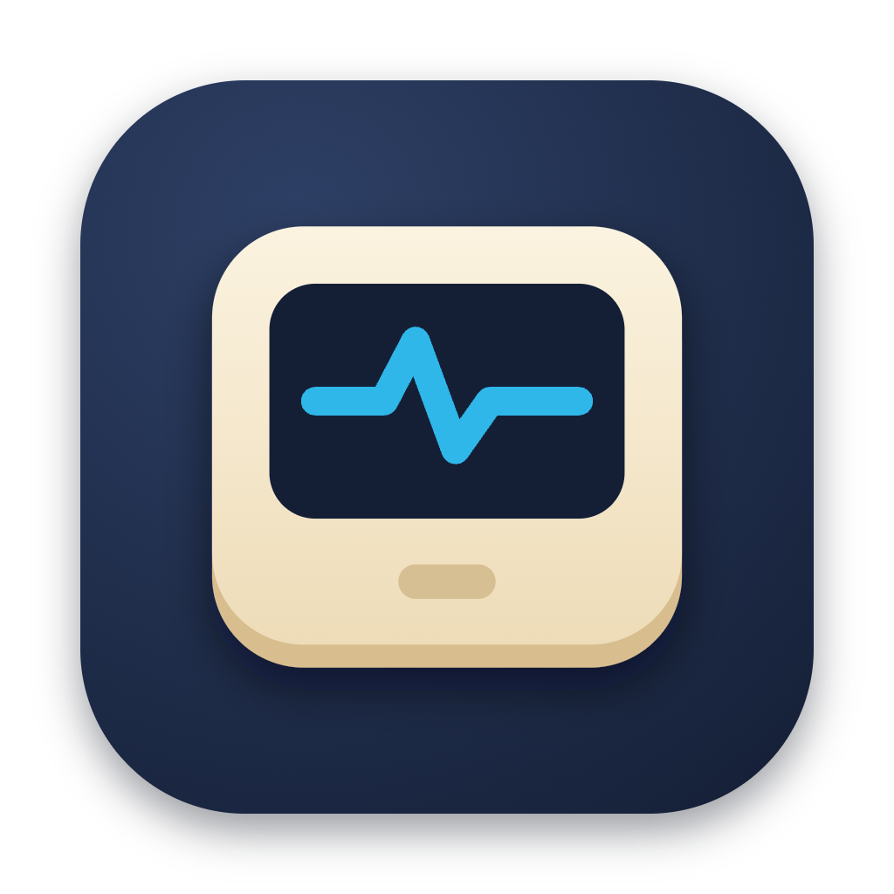
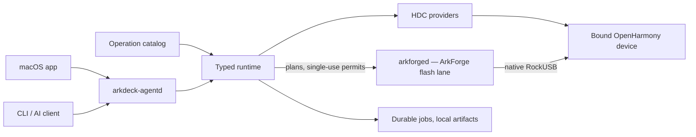

<p align="center">
  <strong>English</strong> · <a href="./README.zh-CN.md">简体中文</a>
</p>

<p align="center">
  
</p>

<h1 align="center">ArkDeck</h1>

<p align="center">
  Debug, trace, and flash real OpenHarmony devices from a macOS app, a CLI, or an AI agent.
</p>

<p align="center">
  <a href="https://github.com/ArkDeck/ArkDeck/actions/workflows/swift-ci.yml"></a>
  
  
  
  <a href="./LICENSE"></a>
</p>

ArkDeck is a local-first workbench for real OpenHarmony development boards. A
macOS app, a CLI, and a per-user daemon share one Rust runtime that adopts a
specific device, runs versioned operations from a published catalog, keeps
durable job history, and stores artifacts locally.

Callers never submit raw `hdc` or shell command strings, executable paths,
remote paths, or trusted device facts. They submit a published operation and
typed inputs. The daemon materializes the executable, the argument array, and
provider-owned paths, checks the bound device, and stops when a required fact
is missing or has drifted. AI agents use the same bounded operation surface as
the app and the CLI.

ArkDeck is the main repository of the [ArkDeck organization](https://github.com/ArkDeck).
Two sibling repositories supply parts of the product:

- [ArkForge](https://github.com/ArkDeck/ArkForge) — the flashing mechanics
  (`arkforged`, native RockUSB for the DAYU200 / RK3568), pinned by commit in
  [`rust/Cargo.toml`](./rust/Cargo.toml).
- [ArkTrace](https://github.com/ArkDeck/ArkTrace) — the trace engine and viewer
  support used by the Trace workspace, pinned by commit in
  [`apple/Packages/ArkDeckKit/Package.swift`](./apple/Packages/ArkDeckKit/Package.swift).

## Contents

- [Status](#status)
- [Features](#features)
- [Architecture](#architecture)
- [Requirements](#requirements)
- [Building from source](#building-from-source)
- [Installing the runtime](#installing-the-runtime)
- [Repository layout](#repository-layout)
- [Documentation](#documentation)
- [Contributing](#contributing)
- [Security](#security)
- [License](#license)

## Status

ArkDeck is an early preview (`0.1.0`) under active development. There are no
tagged releases; build from source.

- macOS 27 on Apple silicon is the only supported product host.
- Flashing supports one board: the DAYU200 (RK3568).
- A Windows 11 x64 WinUI 3 client is in development in [`windows/`](./windows/).
  It is not a supported host yet.
- Linux has no desktop client. CI builds and tests the shared Rust workspace on
  Linux; a Linux product port has not started.
- Interfaces, catalog schemas, and setup steps may change before a stable release.

Product progress is judged by journeys that must pass on a physical board, not
on mocks or simulators. Their definitions are kept in
[docs/archive/PRODUCT-LOOP.md](./docs/archive/PRODUCT-LOOP.md).

## Features

Operations are published in [`catalog/operations/`](./catalog/operations/). The
current catalog covers:

- **Device observation and adoption** — observe HDC and adopt one exact device
  by durable identity instead of whichever device happens to be connected.
- **HAP debugging** — install, start, verify, and clean up HAPs from leased
  artifacts, with optional bounded diagnostics.
- **Diagnostics capture** — HiLog, screenshots and screen sequences, ArkUI
  component trees, traces, and crash records, written to an immutable local
  artifact store.
- **Input automation** — tap, long press, swipe, and keyboard input.
- **Native deployment** — verified, target-bound port forwards and atomic
  deployment of app-owned native libraries with rollback.
- **Flashing** — DAYU200 flashing from a verified image bundle through
  ArkForge, plus full restore, recommissioning, post-flash verification, and
  boot-loop restoration.
- **Analysis** — trace summaries and analysis, HiLog summaries, and crash
  signature extraction.
- **Agent debug loop** — an external agent can analyze artifacts, patch a
  runtime-owned isolated workspace, build, sign, redeploy, and verify. Every
  side effect goes through the same typed admission as any other caller.

These surfaces drive the same runtime:

| Surface | Description |
| --- | --- |
| macOS app | Overview, Flash, Debug, UI Dump, Trace, Device, Diagnostics, and History workspaces, plus per-device detail views. Settings live in the standard Settings window. This is the supported desktop client. |
| Windows app | WinUI 3 client in [`windows/`](./windows/) (Windows 11 x64, in development). It reads the local Rust daemon through ArkDeck.ClientKit and holds no runtime semantics. |
| `arkdeck` | CLI for daemon and signing setup, device adoption, operations and jobs, artifacts, agent runs, and bounded debug tasks. |
| `arkdeck-agentd` | Per-user daemon that owns execution, recovery, and the private control socket. |

### Design principles

Boards get bricked by ordinary mistakes: a flash aimed at the wrong serial
number, a cleanup that removes the wrong remote directory, a script that keeps
going after a step silently failed. ArkDeck moves that responsibility from the
caller into the runtime:

- Mutating work requires a confirmed, persisted device binding. A transport
  address alone is never treated as an identity.
- Intent is journaled before each external effect, so a daemon crash or restart
  does not lose track of work in flight.
- Destructive work runs under a short-lived, runtime-owned capability tied to
  the exact operation, device, inputs, plan, artifacts, and toolchain.
- When facts are stale or an outcome is unknown, the runtime stops instead of
  guessing.
- Raw artifacts stay on your machine and are immutable once written. Exporting
  anything is an explicit step.

## Architecture



The runtime, CLI, and providers are the Rust workspace in [`rust/`](./rust/).
Swift carries no runtime semantics: the SwiftPM package in
`apple/Packages/ArkDeckKit` builds only the app-side libraries.

Flash execution lives in `arkforged`, a daemon built from the
[ArkForge repository](https://github.com/ArkDeck/ArkForge) and spawned by
`arkdeck-agentd`. ArkDeck decides who may do what to which bound device: it
materializes the plan, signs single-use step permits, answers the daemon's
device-control requests with observations, and never hands over HDC or the
connect key. `arkforged` decides how the authorized plan lands on the device.
RockUSB is implemented natively in that daemon; no vendor flashing tool runs on
the product path.

Module boundaries are documented in [Architecture Rules](./docs/ArchitectureRules.md).

## Requirements

- macOS 27 on Apple silicon, for the desktop app
- Xcode 27.0 with Swift 6.4, for the app and the Swift package
- Rust stable, 1.99.0 or newer ([`rust/rust-toolchain.toml`](./rust/rust-toolchain.toml)),
  for the runtime and CLI
- Python 3, for the build and check scripts
- [`just`](https://github.com/casey/just) (optional), for the shortcuts in the root [`justfile`](./justfile)
- an OpenHarmony `hdc` executable and a USB-connected device with first-use
  trust granted, for real-device work
- .NET SDK 10.0.401 ([`windows/global.json`](./windows/global.json)), only for
  the Windows client

## Building from source

```bash
git clone https://github.com/ArkDeck/ArkDeck.git
cd ArkDeck
```

The root [`justfile`](./justfile) wraps the repository scripts. Run `just` to
list the recipes.

| Task | `just` recipe | Underlying command |
| --- | --- | --- |
| Build the Rust workspace | `just build-rust` | `python3 rust/scripts/run-cargo.py build` |
| Build the Swift package | `just build-swift` | `sh apple/Packages/ArkDeckKit/Scripts/run-swiftpm.sh build` |
| Build the macOS app | `just build-app` | `sh hack/ci/run-xcodebuild.sh` |
| Test a Rust crate (default `arkdeck-cli`) | `just test-rust <crate>` | `python3 rust/scripts/run-cargo.py test -p <crate>` |
| Test the Swift package | `just test-swift` | `sh apple/Packages/ArkDeckKit/Scripts/run-swiftpm.sh test --parallel` |
| Format check, clippy, SDD check | `just lint` | see the [`justfile`](./justfile) |
| SDD and catalog consistency | `just sdd` | `sh hack/check-sdd.sh` |
| Check the ArkForge pin | `just pin` | `python3 rust/scripts/check-arkforge-pin.py` |
| Path-aware local CI plan | `just ci` | `python3 hack/ci/plan.py --repo-root . --base-revision origin/main --head-revision HEAD --merge-base --include-worktree --run-local` |

`just build` and `just test` run the Rust and Swift entries together.

Notes:

- `run-cargo.py` runs Cargo with the workspace toolchain, `--locked`, and two
  build jobs, using a persistent cache outside the checkout (under
  `~/Library/Caches/com.arkdeck.ArkDeck/` on macOS). Set
  `ARKDECK_CARGO_CACHE_ROOT` to an absolute path outside the checkout if the
  default location is unavailable, and `ARKDECK_CARGO_OWNER` to separate caches
  between concurrent sessions.
- The ArkForge crates are fetched from GitHub at the full commit revision pinned
  in [`rust/Cargo.toml`](./rust/Cargo.toml). `check-arkforge-pin.py
  --run-vectors` also reruns ArkForge's wire and StepPermit vectors at that
  revision.
- `just build-app --release` builds a locally signed, optimized arm64 app
  without notarizing or installing it. Set `ARKDECK_XCODE_JOBS` (1–64) to limit
  parallel build tasks on a memory-constrained host.
- The native ArkTrace runtime is linked only when its SDK is staged
  (`ARKTRACE_RUST_XCFRAMEWORK`); CI prepares it with
  [`hack/ci/prepare-native-trace.py`](./hack/ci/prepare-native-trace.py).
- The Windows client builds with
  `dotnet build windows/ArkDeck.Windows.slnx -c Release`; see
  [windows/README.md](./windows/README.md).

For app development, you can also open `apple/ArkDeck.xcodeproj` in Xcode and run
the shared `ArkDeck` scheme. This is enough for app work and host-side tests.

## Installing the runtime

The background runtime is the Rust `arkdeck-agentd`, packaged as a signed
`ArkDeckAgent.app` inside `ArkDeckCLI.app`. SwiftPM does not build it.
`runtime service install` accepts the helper only when it has the expected
Developer ID, hardened runtime, embedded provisioning profile, and shared
Keychain entitlement. Building and signing it needs team-authorized signing
inputs; see the [headless runtime guide](./apple/Packages/ArkDeckKit/LaunchAgents/README.md).
Flashing a DAYU200 also needs the signed `arkforged` from ArkForge.

With a signed `ArkDeckCLI.app`, install the per-user daemon by naming the
reviewed bundle and tool generations, then check the setup:

```bash
ARKDECK=/absolute/path/to/ArkDeckCLI.app/Contents/MacOS/arkdeck

"$ARKDECK" runtime service install \
  --bundle <bundle-id> --bundle-generation <n> \
  --tool <tool-id> --tool-generation <n>
"$ARKDECK" runtime service status
"$ARKDECK" doctor
"$ARKDECK" operation list
```

Adopt a device after reviewing the candidates. ArkDeck does not guess when the
choice is absent or ambiguous:

```bash
"$ARKDECK" device candidates --output json
"$ARKDECK" target adopt --candidate <key> \
  --observation <id> --observation-generation <generation>
```

See [exact-observation adoption](./docs/design/cli-exact-observation-adoption.md).
Workspace setup, local HAP signing, diagnostics, and uninstall are covered in
the headless runtime guide.

## Repository layout

| Path | Contents |
| --- | --- |
| [`apple/`](./apple/) | Xcode project, the SwiftUI macOS app, its UI tests, and the `ArkDeckKit` Swift package (app-side libraries) |
| [`rust/`](./rust/) | Rust workspace: daemon, CLI, contracts, control plane, host store, platform layer, and the HDC, ArkForge, and workspace providers |
| [`windows/`](./windows/) | Windows 11 x64 WinUI 3 client, ArkDeck.ClientKit, and their tests (in development) |
| [`catalog/`](./catalog/) | Published operations, profiles, and schemas |
| [`api/`](./api/) | Language-neutral control, recovery, and UI-semantics contracts |
| [`openspec/`](./openspec/) | Product contracts, safety invariants, and change history |
| [`docs/`](./docs/) | Architecture rules, ADRs, design notes, release design notes, and the archive |
| [`hack/`](./hack/) | Repository checks, CI planner, and tooling |
| [`test/fixtures/`](./test/fixtures/) | Host-side product demos, including WaterFlowTraceDemo |
| [`tools/experiments/`](./tools/experiments/) | Experiments kept off the product layout; CI still runs `host_loop` and `gj_record` |
| [`.design-sync/`](./.design-sync/) | Design-sync notes for the `@arkdeck/ds` tokens, read by the CI planner and the Windows component map |
| [`.github/`](./.github/) | Workflows, CODEOWNERS, and issue and pull request templates |

## Documentation

- [Architecture Rules](./docs/ArchitectureRules.md) and [ADRs](./docs/adr/)
- [OpenSpec](./openspec/README.md) — product contracts and change history
- [Headless runtime guide](./apple/Packages/ArkDeckKit/LaunchAgents/README.md)
- [Rust workspace](./rust/README.md) and [Windows client](./windows/README.md)
- [Design notes](./docs/design/)
- [Changelog](./CHANGELOG.md)

## Contributing

Start with [CONTRIBUTING.md](./CONTRIBUTING.md). [AGENTS.md](./AGENTS.md) defines
the agent and maintainer boundary. The safety invariants under
[`openspec/`](./openspec/) are contracts; changes that weaken them are not
merged. Community expectations are in [CODE_OF_CONDUCT.md](./CODE_OF_CONDUCT.md).

## Security

Report vulnerabilities privately, as described in [SECURITY.md](./SECURITY.md).
Do not open a public issue for a security report.

## License

ArkDeck is released under the [MIT License](./LICENSE).
