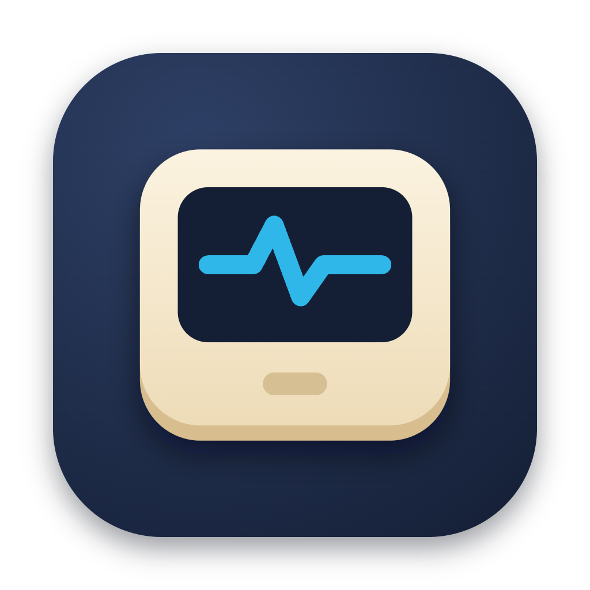
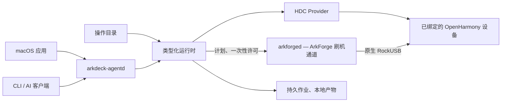

<p align="center">
  <a href="./README.md">English</a> · <strong>简体中文</strong>
</p>

<p align="center">
  
</p>

<h1 align="center">ArkDeck</h1>

<p align="center">
  用 macOS 应用、CLI 或 AI Agent，调试、跟踪、刷写真实的 OpenHarmony 设备。
</p>

<p align="center">
  <a href="https://github.com/ArkDeck/ArkDeck/actions/workflows/swift-ci.yml"></a>
  
  
  
  <a href="./LICENSE"></a>
</p>

ArkDeck 是一个面向真实 OpenHarmony 开发板的本地优先工作台。macOS 应用、CLI
和用户级守护进程共用同一个 Rust 运行时：接管一台确定的设备，执行已发布操作目录中的
版本化操作，持久保存任务历史，并把产物存放在本地。

调用方不能提交任意 `hdc` 或 shell 命令字符串、可执行文件路径、远端路径，也不能提供
可信设备事实。调用方只提交已发布的操作和类型化输入；守护进程负责生成可执行文件、
参数数组和 Provider 管理的路径，核对已绑定设备，在必要事实缺失或漂移时停止。
AI Agent 与应用和 CLI 共用这一套有界操作面。

ArkDeck 是 [ArkDeck 组织](https://github.com/ArkDeck)的主仓库，另有两个兄弟仓库
提供产品的一部分：

- [ArkForge](https://github.com/ArkDeck/ArkForge)：刷机机械层（`arkforged`，面向
  DAYU200 / RK3568 的原生 RockUSB），在 [`rust/Cargo.toml`](./rust/Cargo.toml)
  中按提交固定。
- [ArkTrace](https://github.com/ArkDeck/ArkTrace)：Trace 工作区使用的 Trace 引擎与
  查看器支持，在 [`apple/Packages/ArkDeckKit/Package.swift`](./apple/Packages/ArkDeckKit/Package.swift)
  中按提交固定。

## 目录

- [状态](#状态)
- [功能](#功能)
- [架构](#架构)
- [环境要求](#环境要求)
- [从源码构建](#从源码构建)
- [安装运行时](#安装运行时)
- [仓库结构](#仓库结构)
- [文档](#文档)
- [参与贡献](#参与贡献)
- [安全](#安全)
- [协议](#协议)

## 状态

ArkDeck 是早期预览版（`0.1.0`），仍在积极开发中。没有打过 tag 的发布版本，请从
源码构建。

- 目前唯一受支持的产品宿主是 Apple 芯片上的 macOS 27。
- 刷机只支持一块开发板：DAYU200（RK3568）。
- Windows 11 x64 的 WinUI 3 客户端正在 [`windows/`](./windows/) 中开发，还不是受支持的宿主。
- Linux 没有桌面客户端。CI 会在 Linux 上构建和测试共享的 Rust 工作区；Linux 产品移植尚未开始。
- 在稳定版之前，接口、操作目录 Schema 和安装步骤都可能变化。

产品进度以必须在实体开发板上跑通的闭环来衡量，Mock 和模拟器不算数。这些闭环的定义保存在
[docs/archive/PRODUCT-LOOP.md](./docs/archive/PRODUCT-LOOP.md)。

## 功能

操作发布在 [`catalog/operations/`](./catalog/operations/) 中。当前操作目录覆盖：

- **设备观察与接管**：观察 HDC，并按持久设备身份接管一台确定的设备，而不是选择当前碰巧连接的设备。
- **HAP 调试**：从带租约的产物安装、启动、验证并清理 HAP，可选采集有界诊断信息。
- **诊断采集**：HiLog、截图与屏幕序列、ArkUI 组件树、Trace 和崩溃记录，写入不可变的本地产物库。
- **输入自动化**：点击、长按、滑动和键盘输入。
- **Native 部署**：经过验证、绑定目标设备的端口转发，以及应用自有 native 库的原子化部署，失败时回滚。
- **刷机**：通过 ArkForge 用已验证的镜像包刷写 DAYU200，以及整机恢复、重新投运、刷机后验证和启动循环恢复。
- **分析**：Trace 摘要与分析、HiLog 摘要、崩溃签名提取。
- **Agent 调试循环**：外部 Agent 可以分析产物、在运行时持有的隔离工作区打补丁、构建、签名、
  重新部署并复验。每个副作用都与其他调用方走同一条类型化准入。

这些入口共用同一个运行时：

| 入口 | 说明 |
| --- | --- |
| macOS 应用 | Overview、Flash、Debug、UI Dump、Trace、Device、Diagnostics 和 History 工作区，以及单台设备的详情视图。应用设置位于标准 Settings 窗口。这是目前受支持的桌面客户端。 |
| Windows 应用 | [`windows/`](./windows/) 中的 WinUI 3 客户端（Windows 11 x64，开发中）。它通过 ArkDeck.ClientKit 读取本地 Rust 守护进程，自身不持有运行时语义。 |
| `arkdeck` | CLI：配置守护进程与签名、接管设备、操作与作业、产物、Agent 运行和有界调试任务。 |
| `arkdeck-agentd` | 用户级守护进程：负责实际执行、故障恢复和私有控制 socket。 |

### 设计原则

开发板往往毁于普通的失误：刷机对准了错误的序列号，清理删错了远端目录，某一步悄悄失败后
脚本还在继续。ArkDeck 把这些责任从调用方移到运行时：

- 有副作用的操作必须基于已确认、已持久化的设备绑定；单凭传输地址永远不算设备身份。
- 每个外部副作用之前先写入意图日志，守护进程崩溃或重启也不会丢失进行中的工作。
- 破坏性操作在短期有效、由运行时持有的能力下执行，该能力绑定确切的操作、设备、输入、计划、产物和工具链。
- 事实过期或结果未知时，运行时停止，而不是猜测。
- 原始产物留在本机，写入后不可变；导出任何内容都需要显式操作。

## 架构



运行时、CLI 和 Provider 都在 [`rust/`](./rust/) 的 Rust 工作区中。Swift 不承载运行时
语义：`apple/Packages/ArkDeckKit` 中的 SwiftPM 包只构建应用侧的库。

刷机由 `arkforged` 执行。它从 [ArkForge 仓库](https://github.com/ArkDeck/ArkForge)
构建，由 `arkdeck-agentd` 启动。ArkDeck 决定谁可以对哪台已绑定设备做什么：它生成计划、
签发一次性步骤许可、用观察结果回应守护进程的设备控制请求，并且从不交出 HDC 或 connect key。
`arkforged` 决定已授权的计划如何落到设备上。RockUSB 协议在该守护进程内原生实现，产品路径上
不运行任何厂商刷机工具。

模块边界见 [Architecture Rules](./docs/ArchitectureRules.md)。

## 环境要求

- Apple 芯片上的 macOS 27，用于桌面应用
- Xcode 27.0（Swift 6.4），用于应用和 Swift 包
- Rust stable，1.99.0 或更新（[`rust/rust-toolchain.toml`](./rust/rust-toolchain.toml)），用于运行时和 CLI
- Python 3，用于构建与检查脚本
- [`just`](https://github.com/casey/just)（可选），用于根目录 [`justfile`](./justfile) 中的快捷命令
- 一个 OpenHarmony `hdc` 可执行文件，以及已通过首次信任的 USB 设备，用于真机工作
- .NET SDK 10.0.401（[`windows/global.json`](./windows/global.json)），仅 Windows 客户端需要

## 从源码构建

```bash
git clone https://github.com/ArkDeck/ArkDeck.git
cd ArkDeck
```

根目录 [`justfile`](./justfile) 封装了仓库已有的脚本，运行 `just` 可列出所有命令。

| 任务 | `just` 命令 | 实际命令 |
| --- | --- | --- |
| 构建 Rust 工作区 | `just build-rust` | `python3 rust/scripts/run-cargo.py build` |
| 构建 Swift 包 | `just build-swift` | `sh apple/Packages/ArkDeckKit/Scripts/run-swiftpm.sh build` |
| 构建 macOS 应用 | `just build-app` | `sh hack/ci/run-xcodebuild.sh` |
| 测试一个 Rust crate（默认 `arkdeck-cli`） | `just test-rust <crate>` | `python3 rust/scripts/run-cargo.py test -p <crate>` |
| 测试 Swift 包 | `just test-swift` | `sh apple/Packages/ArkDeckKit/Scripts/run-swiftpm.sh test --parallel` |
| 格式检查、clippy、SDD 检查 | `just lint` | 见 [`justfile`](./justfile) |
| SDD 与操作目录一致性 | `just sdd` | `sh hack/check-sdd.sh` |
| 检查 ArkForge 固定版本 | `just pin` | `python3 rust/scripts/check-arkforge-pin.py` |
| 按路径选择的本地 CI 计划 | `just ci` | `python3 hack/ci/plan.py --repo-root . --base-revision origin/main --head-revision HEAD --merge-base --include-worktree --run-local` |

`just build` 和 `just test` 会同时运行 Rust 与 Swift 的入口。

说明：

- `run-cargo.py` 使用工作区工具链、`--locked` 和两个构建并发运行 Cargo，缓存放在检出目录
  之外（macOS 上位于 `~/Library/Caches/com.arkdeck.ArkDeck/`）。默认位置不可用时，把
  `ARKDECK_CARGO_CACHE_ROOT` 设为检出目录之外的绝对路径；用 `ARKDECK_CARGO_OWNER`
  区分并发会话的缓存。
- ArkForge crate 按 [`rust/Cargo.toml`](./rust/Cargo.toml) 中固定的完整提交从 GitHub
  获取。`check-arkforge-pin.py --run-vectors` 还会在该提交上重跑 ArkForge 的 wire 与
  StepPermit 向量。
- `just build-app --release` 构建本地签名、优化过的 arm64 应用，不公证也不安装。
  内存紧张的机器可用 `ARKDECK_XCODE_JOBS`（1–64）限制并行构建任务数。
- 只有暂存了 ArkTrace 原生 SDK（`ARKTRACE_RUST_XCFRAMEWORK`）时才会链接原生 ArkTrace
  运行时；CI 用 [`hack/ci/prepare-native-trace.py`](./hack/ci/prepare-native-trace.py) 准备它。
- Windows 客户端用 `dotnet build windows/ArkDeck.Windows.slnx -c Release` 构建，详见
  [windows/README.md](./windows/README.md)。

开发应用时，也可以在 Xcode 中打开 `apple/ArkDeck.xcodeproj`，运行共享的 `ArkDeck`
scheme。这足以完成应用开发和宿主侧测试。

## 安装运行时

后台运行时是 Rust 编写的 `arkdeck-agentd`，打包为签名的 `ArkDeckAgent.app`，位于
`ArkDeckCLI.app` 内。SwiftPM 不构建它。`runtime service install` 只接受具备预期
Developer ID、hardened runtime、内嵌 provisioning profile 和共享 Keychain entitlement
的 helper。构建和签名需要团队授权的签名输入，见
[无头运行时指南](./apple/Packages/ArkDeckKit/LaunchAgents/README.md)。刷写 DAYU200
还需要 ArkForge 中已签名的 `arkforged`。

有了已签名的 `ArkDeckCLI.app` 后，指定已审阅的 bundle 与工具代次来安装用户级守护进程，
然后检查配置：

```bash
ARKDECK=/absolute/path/to/ArkDeckCLI.app/Contents/MacOS/arkdeck

"$ARKDECK" runtime service install \
  --bundle <bundle-id> --bundle-generation <n> \
  --tool <tool-id> --tool-generation <n>
"$ARKDECK" runtime service status
"$ARKDECK" doctor
"$ARKDECK" operation list
```

审阅候选设备后再接管设备。没有候选或候选不唯一时，ArkDeck 不会猜测：

```bash
"$ARKDECK" device candidates --output json
"$ARKDECK" target adopt --candidate <key> \
  --observation <id> --observation-generation <generation>
```

见[按确切观察结果接管设备](./docs/design/cli-exact-observation-adoption.md)。工作区配置、
本地 HAP 签名、诊断和卸载也在无头运行时指南中说明。

## 仓库结构

| 路径 | 内容 |
| --- | --- |
| [`apple/`](./apple/) | Xcode 工程、SwiftUI macOS 应用及其 UI 测试，以及 `ArkDeckKit` Swift 包（应用侧的库） |
| [`rust/`](./rust/) | Rust 工作区：守护进程、CLI、契约、控制面、宿主存储、平台层，以及 HDC、ArkForge 和工作区 Provider |
| [`windows/`](./windows/) | Windows 11 x64 的 WinUI 3 客户端、ArkDeck.ClientKit 及其测试（开发中） |
| [`catalog/`](./catalog/) | 已发布的操作、Profile 与 Schema |
| [`api/`](./api/) | 语言中立的控制面、恢复和 UI 语义契约 |
| [`openspec/`](./openspec/) | 产品契约、安全不变量与变更历史 |
| [`docs/`](./docs/) | 架构规则、ADR、设计笔记、发布设计笔记和归档 |
| [`hack/`](./hack/) | 仓库检查、CI 规划器与工具脚本 |
| [`test/fixtures/`](./test/fixtures/) | 宿主侧产品 demo，包括 WaterFlowTraceDemo |
| [`tools/experiments/`](./tools/experiments/) | 不属于产品布局的实验；CI 仍会运行 `host_loop` 与 `gj_record` |
| [`.design-sync/`](./.design-sync/) | `@arkdeck/ds` token 的 design-sync 笔记，CI 规划器和 Windows 组件映射会读取 |
| [`.github/`](./.github/) | 工作流、CODEOWNERS，以及 issue 与 pull request 模板 |

## 文档

- [Architecture Rules](./docs/ArchitectureRules.md) 与 [ADR](./docs/adr/)
- [OpenSpec](./openspec/README.md)：产品契约与变更历史
- [无头运行时指南](./apple/Packages/ArkDeckKit/LaunchAgents/README.md)
- [Rust 工作区](./rust/README.md)与 [Windows 客户端](./windows/README.md)
- [设计笔记](./docs/design/)
- [变更日志](./CHANGELOG.md)

## 参与贡献

先读 [CONTRIBUTING.md](./CONTRIBUTING.md)。[AGENTS.md](./AGENTS.md) 规定了 Agent 与维护者
的边界。[`openspec/`](./openspec/) 下的安全不变量是契约，削弱它们的改动不会被合入。社区规范
见 [CODE_OF_CONDUCT.md](./CODE_OF_CONDUCT.md)。

## 安全

漏洞请按 [SECURITY.md](./SECURITY.md) 私下报告，不要为安全问题开公开 issue。

## 协议

ArkDeck 以 [MIT 协议](./LICENSE)开源。
